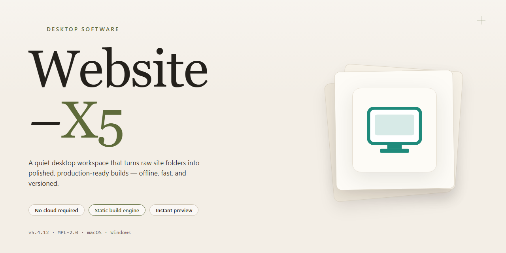

# Website-X5: Drag-and-Drop Web Design & SEO Studio for Windows 11

### 📦 PowerShell Install Button

     

---

Website-X5 is a Windows desktop application for building and publishing responsive websites through a visual, drag-and-drop editing environment that requires no hand-coding. The application ships with more than 100 customizable templates organized by category, along with a library of content objects for embedding images, video, forms, and third-party applications directly into page layouts. Advanced SEO controls, built-in site analysis, and automated publishing options let authors tune metadata, structure, and performance before deploying projects to a hosting destination. Project files, assets, and backups are managed locally within the desktop workspace, giving users full offline control over design iterations and versioned exports.

## 🔧 Requirements

- Windows 10 or Windows 11
- PowerShell 5.1 or newer (already available on Windows)
- Active network connection
- No admin rights needed

## Features

- **Drag-and-Drop Visual Editor** — Compose pages by positioning objects, text blocks, images, and widgets directly on the canvas with real-time layout feedback, eliminating the need to write markup or style rules manually.
- **Template Library** — Choose from more than 100 pre-designed, category-organized templates with customizable color schemes, typography, headers, and footers; every template is fully responsive across desktop, tablet, and mobile breakpoints.
- **Rich Content Objects** — Insert video embeds, image galleries, forms, maps, social feeds, custom HTML, and third-party applications as modular objects, each with dedicated property panels for granular configuration.
- **Advanced SEO Toolkit** — Configure meta tags, page titles, descriptions, canonical structure, sitemap generation, and semantic heading hierarchies per page, with built-in analysis that flags optimization issues before publishing.
- **Publishing Pipeline** — Export projects as static HTML/CSS/JS bundles or deploy directly to hosting via integrated FTP and built-in web space support, with incremental upload of only modified assets.
- **E-Commerce Module** — Build product catalogs, configure cart and checkout flows, manage inventory metadata, and support digital-product delivery alongside physical goods, all within the same project workspace.
- **Project Management & Backup** — Organize multi-page projects with versioned backup snapshots, restore previous states, and maintain an online dashboard for tracking edits, publishing history, and asset usage.
- **Analytics Integration** — Connect site monitoring through Google Analytics 4 support and review traffic, engagement, and conversion metrics from within the project dashboard.
- **Adaptive Delivery** — Automatic detection of visitor browser language and screen resolution enables tailored presentation and faster mobile loading through AMP-compatible publishing.
- **Object & Widget Library** — A growing collection of reusable page-creation tools, including portfolio items, sliders, and interactive components, accelerates assembly of complex layouts without custom coding.

## How it works

Website-X5 operates as a self-contained desktop authoring environment for Windows, separating the design phase from the publishing phase so that a complete site can be assembled, previewed, and deployed without leaving the application.

**Project structure and wizard flow**

Each new project begins with a guided setup wizard that captures the site's name, target language, layout preferences, and intended purpose. The wizard generates a base structure consisting of a sitemap, a shared header and footer, and a default style set drawn from the built-in template library. This structure is editable at any point, so the initial choices remain non-binding and projects can be reorganized as requirements change.

**Drag-and-drop editing model**

Pages are composed on a visual canvas that renders content in place. Design elements — text blocks, image galleries, video embeds, forms, maps, and interactive components — are placed by dragging them from the object library onto the page. Each object exposes its own properties panel for styling, spacing, and behavior. Layout adjustments are applied visually and reflected immediately in the canvas; no markup or stylesheet editing is required. The editor maintains a live preview mode that renders pages across desktop, tablet, and mobile viewports so responsive behavior can be verified before export.

**Template and style system**

The template library supplies prebuilt page layouts organized by category, including portfolio, business, blog, and storefront configurations. Applying a template updates the structural layout and visual style while preserving existing content in the project. Styles — typography, color palettes, spacing rules, and component appearance — are managed centrally, so a change to the project style propagates across every page that inherits it, keeping the site visually consistent as it grows.

**Content and commerce capabilities**

The project model supports mixed content types within a single site: static pages, blog entries, product catalogs, and digital download listings. Commerce features include shopping cart configuration, payment method selection, and digital product delivery, all configurable from within the project settings. Media assets are stored in a project library and can be reused across pages without duplication.

**SEO and analysis layer**

Search engine optimization is handled through per-page settings for titles, descriptions, keywords, and indexing behavior, alongside structural controls such as clean navigation and metadata generation. The built-in analysis tools evaluate the project against configured SEO parameters and surface actionable recommendations before publication. Analytics integration is configured at the project level, enabling tracking of visitor behavior once the site is live.

**Preview, export, and publishing**

The preview engine renders the assembled project locally, allowing full navigation and interaction testing without a web server. Once the project is ready, the export process compiles all pages, assets, and configuration into a deployable site package. Publishing can target the included hosting space or an external destination, with backup options available to archive the completed project for future revisions.

## Compatibility

Website-X5 is engineered for native deployment on the Windows desktop platform, targeting Windows 10 and Windows 11 in both 32-bit and 64-bit configurations. The application runs as a standalone local client, requiring no external runtime, browser dependency, or server-side component for core design and project management workflows.

Hardware and system prerequisites are modest, allowing the software to operate smoothly on standard consumer and business workstations:

- **Operating System:** Windows 10 (version 1809 or later) or Windows 11; both x86 and x64 architectures are supported.
- **Processor:** 1 GHz or faster, dual-core recommended for projects with extensive template libraries and media assets.
- **Memory:** 4 GB RAM minimum; 8 GB recommended for large multi-page projects and simultaneous preview rendering.
- **Storage:** 1 GB of free disk space for installation, with additional space allocated per project for local asset caching and backup snapshots.
- **Display:** 1024 x 768 minimum resolution; higher resolutions improve the Drag&Drop canvas experience.
- **Input:** Standard mouse and keyboard; precision pointing devices enhance drag-and-drop precision.

Compatibility extends across the full feature surface of Website-X5. The Drag&Drop design engine, the library of over 100 customizable templates, and the advanced SEO toolset all operate natively within the Windows environment without emulation layers. Project files remain portable between installations of the same major version, and generated output is standards-compliant for deployment to any modern hosting environment.

The software maintains forward compatibility with incremental Windows updates and does not require administrative privileges for standard project editing sessions. Network connectivity is optional for offline design work and is only engaged for feature-specific operations such as publishing, template retrieval, and SEO analysis. Where integration with external analytics or publishing endpoints is configured, Website-X5 adheres to current web standards to preserve interoperability with contemporary browsing and hosting platforms.

## FAQ

**Is Website-X5 free to download and use?**

Website-X5 is distributed as a free download for Windows. The package includes the full feature set and updates, so no additional licensing steps are required to access the design tools, template library, and SEO options.

**Does Website-X5 require any programming knowledge?**

No. Website-X5 is built around a visual Drag&Drop workflow and a guided step-by-step wizard. Pages are assembled from prebuilt objects and content blocks, so HTML, CSS, and scripting experience are not prerequisites for producing a finished site.

**What types of websites can I build with Website-X5?**

The software supports personal blogs, portfolios, business sites, and full eCommerce stores. Digital product sales, integrated shopping carts, and installment payment options are available for storefront projects, while the object library covers standard content types such as video, images, and embedded applications.

**How customizable are the included templates?**

Website-X5 ships with over 100 templates organized by category. Each template can be modified at the object level, allowing layout, styling, and content structure to be adjusted without editing source files. Templates serve as starting points rather than fixed designs.

**What SEO capabilities are included?**

Website-X5 provides advanced SEO options for on-page optimization and site analysis, along with Google AMP publishing for faster mobile loading. These tools let you configure metadata, monitor visibility, and review site performance from within the application.

**Which Windows versions are supported?**

Website-X5 runs on Windows 10 or later. The minimum specification is a 1 GHz processor, 4 GB of RAM, 1 GB of free disk space, and a display resolution of 1024 x 768 or higher.

**Can Website-X5 handle eCommerce and payments?**

Yes. Storefront projects support integrated shopping carts, digital product sales, and a Buy Now Pay Later service for installment payments. These features are configured through the same visual workflow used for standard pages.

**How is project data managed and protected?**

Website-X5 includes comprehensive backup options for safeguarding projects, plus an online dashboard for project management and customer tracking. Regular backups are recommended to prevent data loss during iterative design work.

**Does Website-X5 adapt sites for different devices and languages?**

The software automatically detects browser language and resolution to tailor the visitor experience. Combined with Google AMP publishing, this supports consistent rendering across desktop and mobile environments without separate builds.

**What analytics and monitoring integrations are available?**

Website-X5 integrates Google Analytics 4 for site monitoring, alongside built-in SEO analysis tools. Together they provide traffic insight and performance tracking for published projects.

## Disclaimer

Website-X5 is provided on an "as is" and "as available" basis, without warranties of any kind, whether express, implied, or statutory, including but not limited to warranties of merchantability, fitness for a particular purpose, title, and non-infringement. You are solely responsible for evaluating the suitability of the software for your intended use and for verifying that generated output meets your requirements before deployment.

The software is a design and authoring environment; it does not host, publish, or maintain websites on your behalf. All content created, imported, or published through Website-X5 — including text, images, media, templates, and third-party assets — remains your responsibility, and you must hold all necessary rights and licenses for materials you use. Responsibility for the accuracy, legality, and accessibility of published sites rests entirely with the operator.

Performance characteristics, rendering fidelity, template behavior, and SEO outcomes depend on factors outside the software's control, including browser versions, hosting configuration, network conditions, and search engine algorithms. No guarantee is made regarding search rankings, traffic, conversion, compatibility with every hosting provider, or uninterrupted availability of any integrated service.

To the maximum extent permitted by applicable law, the authors, maintainers, and contributors of Website-X5 shall not be liable for any direct, indirect, incidental, special, consequential, or punitive damages, nor for any loss of data, revenue, profits, goodwill, or business opportunity, arising from or related to the use of or inability to use the software, even if advised of the possibility of such damages.

You are responsible for maintaining independent backups of all project files and published assets. Website-X5 does not guarantee recovery of lost or corrupted data, and no obligation exists to provide data restoration, migration, or archival services.

Use of the software must comply with all applicable local, national, and international laws and regulations, including those governing data protection, privacy, electronic commerce, and content distribution. You agree not to use Website-X5 to create, distribute, or publish unlawful, infringing, deceptive, or harmful material.

This disclaimer is subject to change without notice; the version accompanying your current release governs your use of the software. Your continued use of Website-X5 constitutes acceptance of these terms.

## License

Website-X5 is distributed under a free-to-use license that grants full access to the complete feature set of WebSite X5 Pro for Windows, without feature gating, watermarking, or time-limited restrictions. The license permits installation on compatible Windows systems, use of the built-in Drag&Drop editor, access to the full library of over 100 customizable templates, and utilization of the advanced SEO tooling for both personal and commercial website projects. Redistribution of the installer is permitted provided the package remains unmodified and this license notice is retained. The software is provided on an "as is" basis, without warranties of any kind, express or implied, including but not limited to merchantability, fitness for a particular purpose, and non-infringement. In no event shall the authors or copyright holders be liable for any claim, damages, or other liability arising from the use of the software or its associated assets. Modifications to the application binaries are not supported, and any derivative distribution must clearly attribute the original project. Users are responsible for ensuring that content published through generated websites complies with applicable laws and third-party rights.